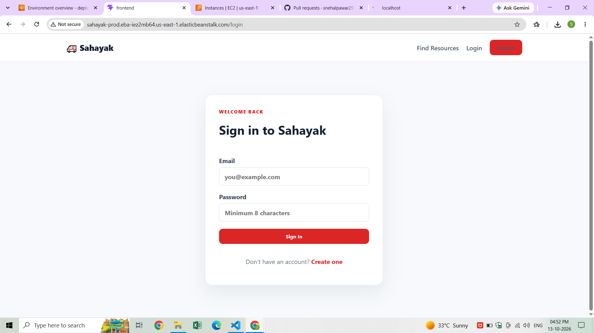
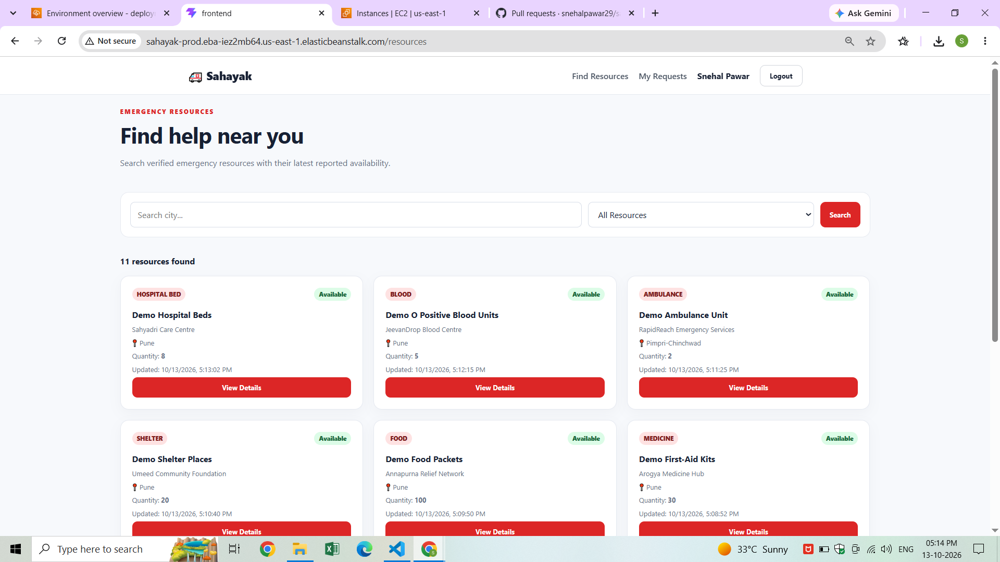
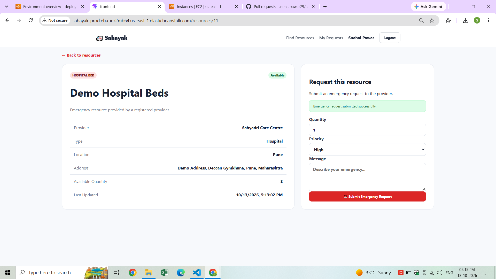
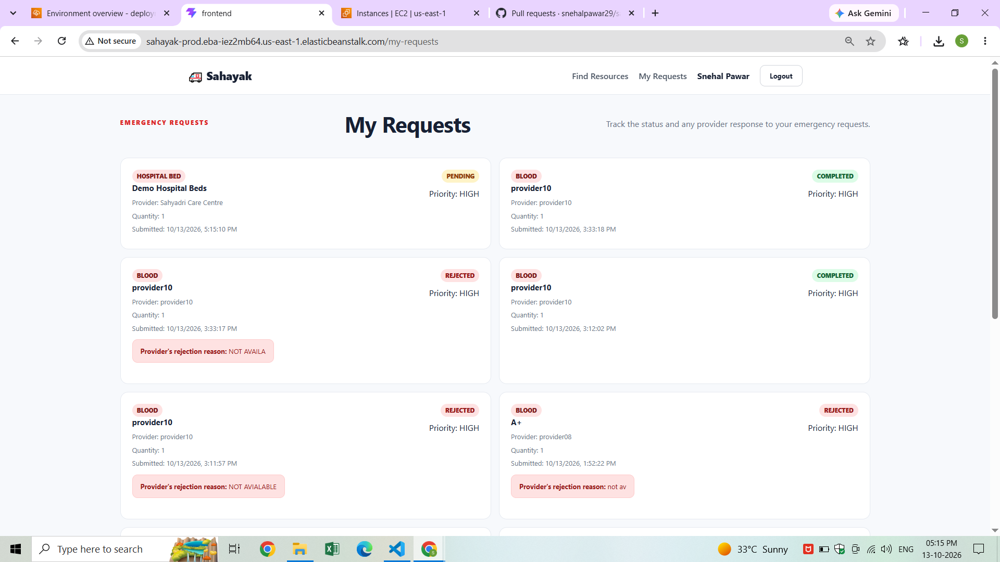
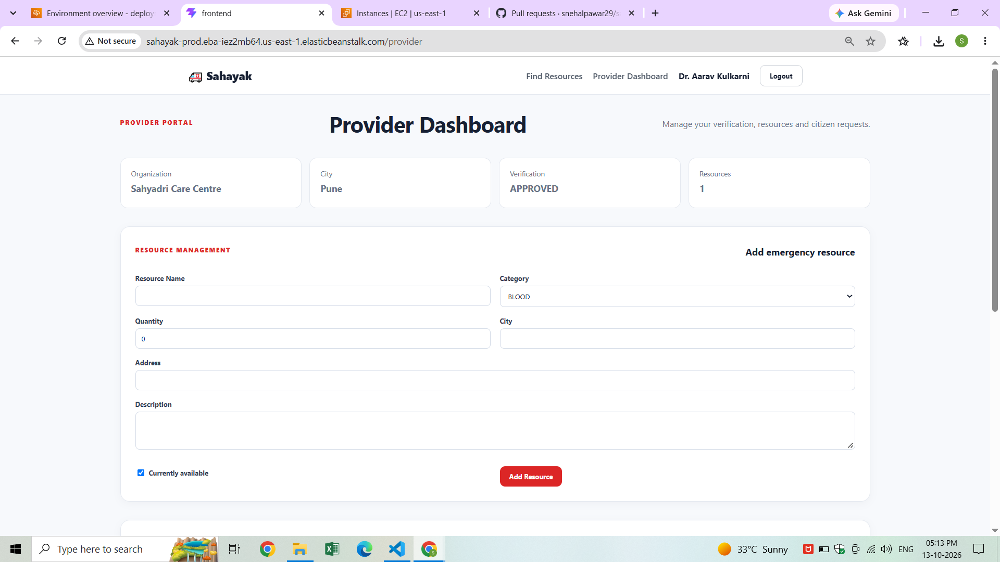
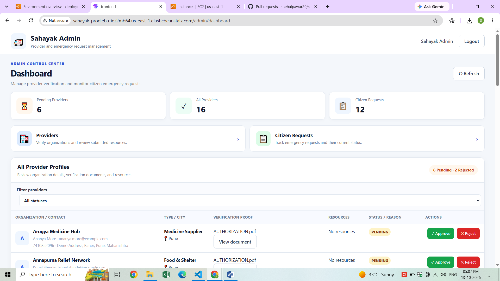
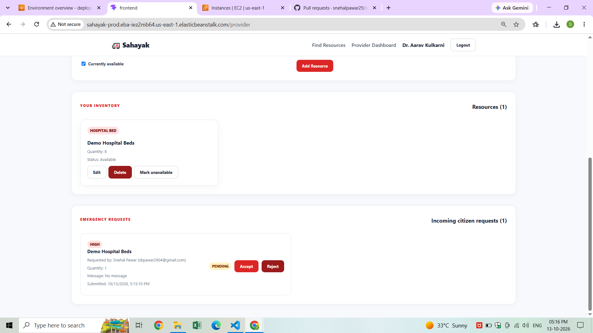

# 🚨 Sahayak — Emergency Resource Finder

<p align="center">
  
  
  
  
  
</p>

<p align="center">
  <b>Connecting people with essential emergency resources when every minute matters.</b>
</p>

<p align="center">
  <a href="https://github.com/snehalpawar29/sahayak">📂 Repository</a> •
  <a href="SAHAYAK_DEPLOYMENT_GUIDE.md">☁️ Deployment Guide</a> •
  <a href="https://github.com/snehalpawar29">👩‍💻 Developer</a>
</p>

---

## 🌟 About the Project

**Sahayak** is an emergency resource finder designed to help people discover essential resources and submit requests through a centralized platform.

It connects three types of users:

- 🧑 **Citizens** — discover available resources and submit or track requests.
- 🏥 **Resource Providers** — register their organizations and manage resource availability.
- 🛡️ **Administrators** — review provider verification requests and manage platform activity.

The project combines full-stack application development with containerization and cloud deployment practices.

## 🏗️ System Architecture

<p align="center">
  
</p>

<p align="center">
  <i>High-level view of the application components and their interactions.</i>
</p>

### 🔄 How the Application Works

```text
                 👥 USERS
                    |
          +---------+---------+
          |         |         |
       Citizen   Provider   Admin
          |         |         |
          +---------+---------+
                    |
             🌐 React Frontend
                    |
             🔗 REST API Requests
                    |
          ⚙️ Node.js + Express
                    |
             🔐 Authentication
             🛡️ Role Permissions
             ✅ Provider Verification
                    |
             🗄️ PostgreSQL
                    |
       Users | Providers | Resources
                    |
                 Requests
```

**Core workflow:** Users interact with the frontend → the backend processes requests and applies authorization rules → application data is read from or written to PostgreSQL.

## ✨ Key Features

| Feature | Description |
|---|---|
| 🔐 Authentication | User authentication and role-based access |
| 🧑 Citizen dashboard | Explore resources and manage requests |
| 🏥 Provider registration | Register as a resource provider |
| ✅ Provider verification | Support administrator review of providers |
| 📦 Resource management | Manage emergency resource listings and availability |
| 📝 Request management | Submit and track emergency resource requests |
| 🛡️ Admin dashboard | Review provider verification and manage platform activity |
| ☁️ Cloud deployment | Deployment configuration for the AWS environment |

### 🆘 Supported Resource Categories

- 🩸 Blood
- 🏥 Hospital beds
- 💊 Medicines
- 🚑 Ambulances
- 🏠 Shelter
- 🍱 Food
- 💧 Water

## 🖥️ Application Preview

### 🏠 Homepage

<p align="center">
  
</p>

### 📦 Available Resources

<p align="center">
  
</p>

### 📝 Resource Request Submission

<p align="center">
  
</p>

### 👤 User Requests

<p align="center">
  
</p>

### 🏥 Provider Dashboard

<p align="center">
  
</p>

### 🛡️ Admin Dashboard

<p align="center">
  
</p>

### 📩 Incoming Requests

<p align="center">
  
</p>

## 🧰 Technology Stack

<table>
  <tr>
    <td><b>🎨 Frontend</b></td>
    <td>React, Vite</td>
  </tr>
  <tr>
    <td><b>⚙️ Backend</b></td>
    <td>Node.js, Express.js, REST APIs</td>
  </tr>
  <tr>
    <td><b>🗄️ Database</b></td>
    <td>PostgreSQL, Prisma ORM</td>
  </tr>
  <tr>
    <td><b>🐳 Containers</b></td>
    <td>Docker, Docker Compose</td>
  </tr>
  <tr>
    <td><b>☁️ Cloud</b></td>
    <td>Amazon Web Services (AWS)</td>
  </tr>
  <tr>
    <td><b>🚀 Deployment</b></td>
    <td>AWS Elastic Beanstalk deployment configuration</td>
  </tr>
  <tr>
    <td><b>🔧 Version Control</b></td>
    <td>Git, GitHub</td>
  </tr>
</table>

## ☁️ DevOps & Cloud Focus

This project is also a practical opportunity to work with application deployment and infrastructure operations.

- 🐳 **Containerization:** Package application components using Docker.
- 🔗 **Service orchestration:** Configure services with Docker Compose.
- ☁️ **AWS deployment:** Prepare and deploy the application using Elastic Beanstalk.
- 🔐 **Configuration management:** Keep environment-specific settings separate from application code.
- 🗄️ **Database operations:** Configure PostgreSQL connectivity and manage Prisma database migrations.
- 🧪 **Troubleshooting:** Investigate API errors, application connectivity, container health, and database configuration.
- 📚 **Documentation:** Maintain architecture and deployment documentation alongside the source code.

## 🚀 Run Locally

### Prerequisites

- Git
- Docker and Docker Compose
- Environment configuration required by the application

### 1. Clone the repository

```bash
git clone https://github.com/snehalpawar29/sahayak.git
cd sahayak
```

### 2. Configure environment variables

Review the backend, frontend, and root `docker-compose.yml` files to identify the environment variables required for your local setup.

Configure your local database URL, authentication secret, and frontend API URL as applicable. **Do not commit real passwords, tokens, or production secrets.**

### 3. Start the application

From the repository root, review the Compose configuration and run:

```bash
docker compose up --build -d
```

Check the service status and logs:

```bash
docker compose ps
docker compose logs --tail=100
```

Use the frontend and backend addresses configured in your environment and Compose files.

For the complete deployment-specific instructions, see **[SAHAYAK_DEPLOYMENT_GUIDE.md](SAHAYAK_DEPLOYMENT_GUIDE.md)**.

## 📁 Repository Structure

```text
sahayak/
├── backend/                    # Express API and application logic
├── frontend/                   # React + Vite frontend
├── docs/
│   └── screenshots/            # Application screenshots and diagrams
├── deployment/
│   └── elastic-beanstalk/      # Elastic Beanstalk deployment files
├── docker-compose.yml          # Local service configuration
├── SAHAYAK_DEPLOYMENT_GUIDE.md # Deployment documentation
└── README.md                   # Project overview
```

*The tree above highlights the main project areas; consult the repository for the complete file structure.*

## 🎯 What This Project Demonstrates

- Full-stack application architecture
- REST API integration
- Role-based access control
- Provider verification workflows
- Relational database integration
- Docker-based development and deployment
- AWS deployment configuration
- Application troubleshooting and technical documentation

## 🔮 Future Improvements

- 📍 Location-based resource discovery
- 🔔 Real-time request status notifications
- 📊 Resource availability analytics
- 🧪 Automated testing and deployment pipelines
- 📈 Centralized monitoring and operational dashboards
- 📱 Improved mobile accessibility

## 👩‍💻 Author

**Snehal Pawar**  
Aspiring DevOps & Cloud Engineer | AWS | Linux | Docker | Kubernetes

<p align="left">
  <a href="https://github.com/snehalpawar29">
    
  </a>
  <a href="https://linkedin.com/in/snehalpawar29">
    
  </a>
</p>

---

<p align="center">
  <b>Built with purpose. Designed to connect people with essential resources. ❤️</b>
</p>
