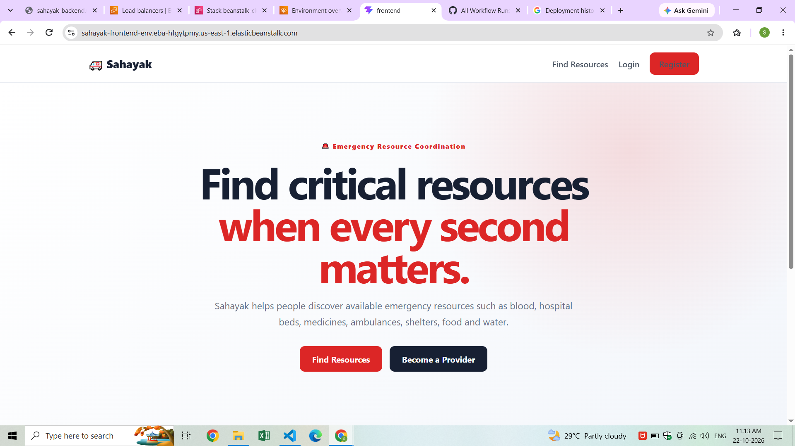
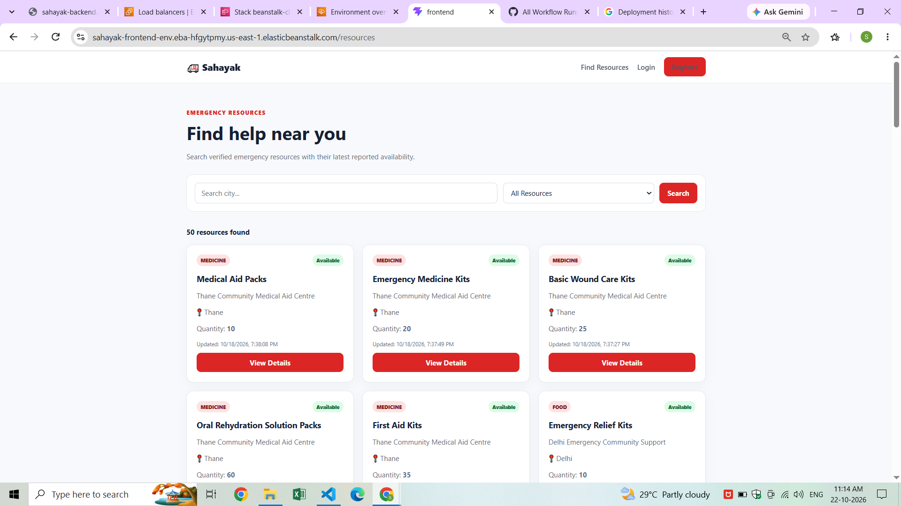
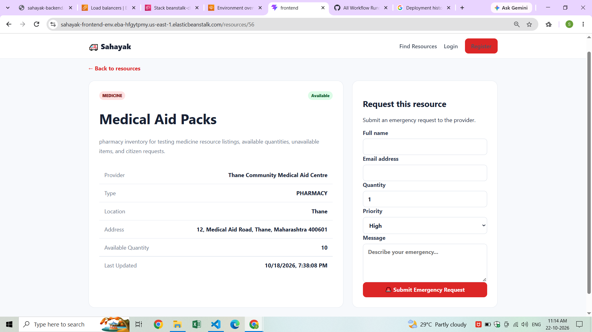
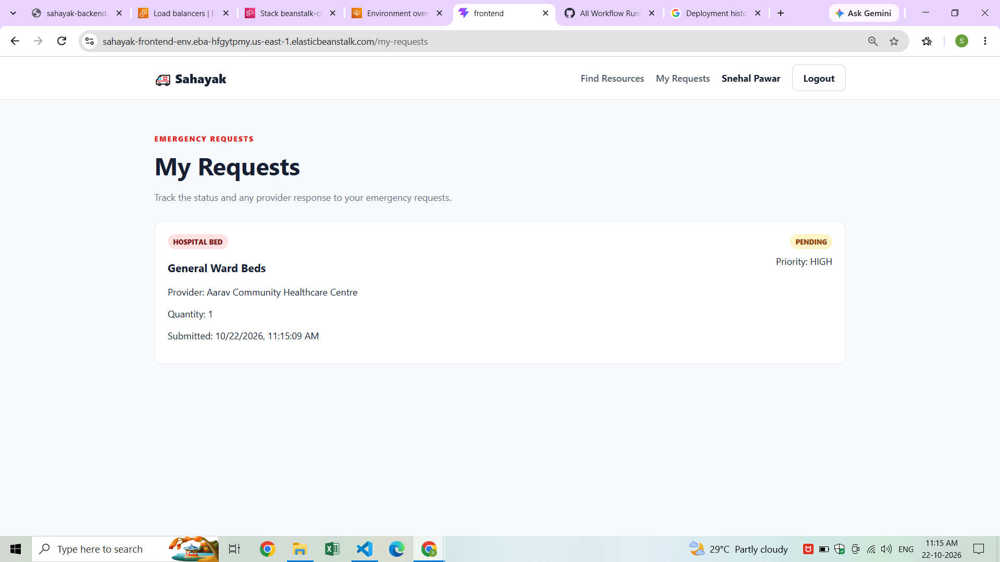
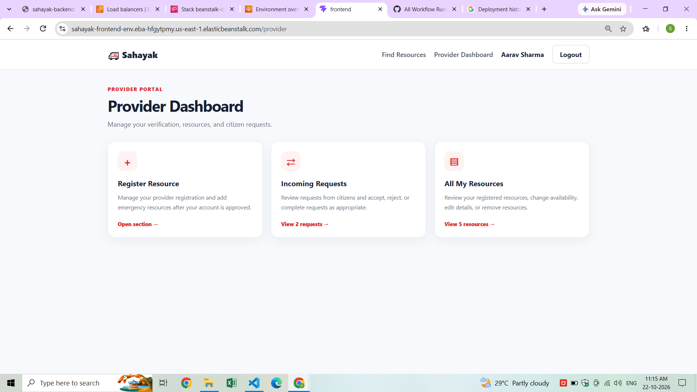
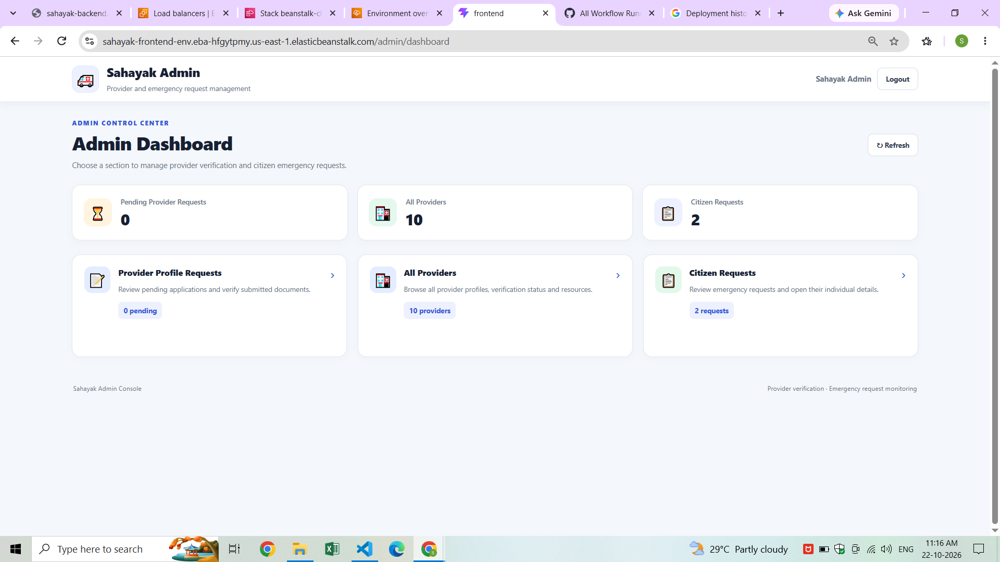

# 🚨 Sahayak — Emergency Resource Finder

<p align="center">
  
  
  
  
  
</p>

<p align="center">
  <b>Connecting people with essential emergency resources when every minute matters.</b>
</p>

<p align="center">
  <a href="https://github.com/snehalpawar29/sahayak">📂 Repository</a> •
  <a href="SAHAYAK_DEPLOYMENT_GUIDE.md">☁️ Deployment Guide</a> •
  <a href="SAHAYAK_WEBSITE_FLOWS.md">🔄 Website Flows</a> •
  <a href="https://github.com/snehalpawar29">👩‍💻 Developer</a>
</p>

---

## 🌟 About the Project

**Sahayak** is an emergency resource finder designed to help people discover essential resources and submit emergency requests through a centralized platform.

It connects three types of users:

- 🧑 **Citizens** — discover available resources and submit or track requests.
- 🏥 **Resource Providers** — register their organizations, submit verification documents, and manage resources after administrator approval.
- 🛡️ **Administrators** — review provider profiles, verify registration documents, and manage platform activity.

The project combines full-stack application development with containerization, AWS infrastructure, and cloud deployment practices.

## 📚 Project Documentation

Use these guides to understand, deploy, and explore Sahayak.

| Documentation | What it covers |
|---|---|
| ☁️ [Complete AWS Deployment Guide](SAHAYAK_DEPLOYMENT_GUIDE.md) | Step-by-step deployment covering Terraform networking, PostgreSQL RDS setup, IAM roles, Elastic Beanstalk Cluster environments, security groups, Parameter Store, and GitHub Actions CI/CD. |
| 🔄 [Website Flows and User Journeys](SAHAYAK_WEBSITE_FLOWS.md) | How citizens, providers, and administrators use the application, including registration, provider profile creation, document verification, resource management, emergency requests, and request status updates. |

**Recommended reading order:** Start with the Website Flows guide to understand the application, then follow the Deployment Guide to deploy it on AWS.

- 📋 [DevOps Process & Hackathon Documentation](docs/DEVOPS_PROCESS.md)

## 🏗️ System Architecture

<p align="center">
  
</p>

<p align="center">
  <i>High-level view of the application components and their interactions.</i>
</p>

### 🔄 How the Application Works

```text
                         👥 USERS
                            |
               +------------+------------+
               |            |            |
            Citizen      Provider      Admin
               |            |            |
               +------------+------------+
                            |
                     🌐 React Frontend
                            |
                     🔗 REST API Requests
                            |
                    ⚙️ Node.js + Express
                            |
               +------------+-------------+
               |            |             |
          Authentication  Role-Based   Provider
                           Access      Verification
               |            |             |
               +------------+-------------+
                            |
                     🗄️ PostgreSQL
                            |
                  Users | Providers
                  Resources | Requests
                            |
                     ☁️ AWS Deployment
                 Elastic Beanstalk Cluster
                      Amazon ECR
                    GitHub Actions
```

**Core workflow:** Users interact with the frontend → the backend authenticates users and enforces authorization → application data is read from or written to PostgreSQL.

## ✨ Key Features

| Feature | Description |
|---|---|
| 🔐 Authentication | User registration, login, and role-based access |
| 🧑 Citizen experience | Explore emergency resources and track submitted requests |
| 🏥 Provider registration | Register an organization and submit verification documents |
| ✅ Provider verification | Administrator review and approval or rejection of provider profiles |
| 📦 Resource management | Create, update, delete, and manage emergency resource availability |
| 🚨 Emergency requests | Submit requests for available resources and follow their status |
| 🛡️ Admin dashboard | Review providers, inspect verification documents, and view emergency requests |
| ☁️ AWS deployment | Cloud deployment using Elastic Beanstalk Cluster environments |
| 🔄 CI/CD | GitHub Actions workflows for building, publishing, and deploying application images |

### 🆘 Supported Resource Categories

- 🩸 Blood
- 🏥 Hospital beds
- 💊 Medicines
- 🚑 Ambulances
- 🏠 Shelter
- 🍱 Food
- 💧 Water

## 🔄 Website User Journeys

Sahayak supports different workflows depending on the user's role.

### 🧑 Citizen Flow

1. Visit Sahayak and browse available emergency resources.
2. Search by city or resource category.
3. Open a resource to view its details and availability.
4. Submit an emergency request either as a guest or as a signed-in citizen.
5. Sign in to view requests associated with the citizen account under **My Requests**.

### 🏥 Provider Flow

1. Register a Sahayak account using the **Resource Provider** account type.
2. Sign in and open the Provider Dashboard.
3. Submit organization details and an authorization or registration document.
4. Wait for administrator verification.
5. If approved, create resources and manage their availability.
6. Review incoming emergency requests and update their status.

Providers must be approved before they can manage resources through the protected provider-resource API.

### 🛡️ Administrator Flow

1. Open the administrator login page.
2. Sign in using an existing account with the `ADMIN` role.
3. Review provider registrations and verification documents.
4. Approve eligible provider profiles or reject them with a reason.
5. Review providers, their resources, and emergency requests in the Admin Dashboard.

For the full flow, including routes, role permissions, API endpoints, database relationships, and implementation notes, read **[SAHAYAK_WEBSITE_FLOWS.md](SAHAYAK_WEBSITE_FLOWS.md)**.

## 🖥️ Application Preview

### 🏠 Homepage

<p align="center">
  
</p>

### 📦 Available Resources

<p align="center">
  
</p>

### 📝 Resource Request Form

<p align="center">
  
</p>

### 👤 User Requests

<p align="center">
  
</p>

### 🏥 Provider Dashboard

<p align="center">
  
</p>

### 🛡️ Admin Dashboard

<p align="center">
  
</p>

## 🧰 Technology Stack

<table>
  <tr>
    <td><b>🎨 Frontend</b></td>
    <td>React, Vite</td>
  </tr>
  <tr>
    <td><b>⚙️ Backend</b></td>
    <td>Node.js, Express.js, REST APIs</td>
  </tr>
  <tr>
    <td><b>🗄️ Database</b></td>
    <td>PostgreSQL, Prisma ORM</td>
  </tr>
  <tr>
    <td><b>🐳 Containers</b></td>
    <td>Docker, Docker Compose</td>
  </tr>
  <tr>
    <td><b>☁️ Cloud</b></td>
    <td>Amazon Web Services (AWS)</td>
  </tr>
  <tr>
    <td><b>🚀 Deployment</b></td>
    <td>AWS Elastic Beanstalk Cluster, Amazon EKS, Amazon ECR</td>
  </tr>
  <tr>
    <td><b>🔄 CI/CD</b></td>
    <td>GitHub Actions, AWS IAM OIDC</td>
  </tr>
  <tr>
    <td><b>🔐 Configuration</b></td>
    <td>AWS Systems Manager Parameter Store</td>
  </tr>
  <tr>
    <td><b>🏗️ Infrastructure</b></td>
    <td>Terraform-managed AWS networking</td>
  </tr>
  <tr>
    <td><b>🔧 Version Control</b></td>
    <td>Git, GitHub</td>
  </tr>
</table>

## ☁️ DevOps & Cloud Focus

This project provides practical experience with application deployment and cloud operations.

- 🐳 **Containerization:** Package application components using Docker.
- 🔗 **Service orchestration:** Configure services with Docker Compose.
- 🏗️ **Infrastructure as Code:** Create and manage AWS networking resources using Terraform.
- ☁️ **Cloud deployment:** Deploy the application using Elastic Beanstalk Cluster environments.
- 📦 **Image management:** Store and retrieve frontend and backend images using Amazon ECR.
- 🔄 **CI/CD automation:** Build, publish, and deploy application images through GitHub Actions.
- 🔐 **Secrets management:** Store production configuration in AWS Systems Manager Parameter Store.
- 🗄️ **Database operations:** Connect to PostgreSQL and apply Prisma migrations.
- 🧪 **Troubleshooting:** Investigate API errors, connectivity, container health, IAM permissions, and deployment failures.
- 📚 **Documentation:** Maintain application workflow and infrastructure deployment guides alongside the source code.

## 🚀 Run Locally

### Prerequisites

- Git
- Docker and Docker Compose
- Environment configuration required by the application

### 1. Clone the repository

```bash
git clone https://github.com/snehalpawar29/sahayak.git
cd sahayak
```

### 2. Configure environment variables

Review the backend, frontend, and root `docker-compose.yml` files to identify the environment variables required for your local setup.

Configure your local database URL, authentication secret, and frontend API URL as applicable.

**Do not commit real passwords, tokens, production database URLs, or other secrets.**

### 3. Start the application

From the repository root, review the Compose configuration and run:

```bash
docker compose up --build -d
```

Check service status and logs:

```bash
docker compose ps
docker compose logs --tail=100
```

Use the frontend and backend addresses configured in your environment and Compose files.

For AWS deployment, follow the **[Complete AWS Deployment Guide](SAHAYAK_DEPLOYMENT_GUIDE.md)**.

## 📁 Repository Structure

```text
sahayak/
├── .github/
│   └── workflows/                 # CI and CD workflows
├── backend/                       # Express API and application logic
├── frontend/                      # React + Vite frontend
├── docs/
│   └── screenshots/               # Application screenshots and diagrams
├── deployment/
│   └── elastic-beanstalk/         # Elastic Beanstalk deployment files
├── terraform/
│   └── networking/                # Terraform-managed VPC and networking
├── docker-compose.yml             # Local service configuration
├── SAHAYAK_DEPLOYMENT_GUIDE.md    # AWS deployment instructions
├── SAHAYAK_WEBSITE_FLOWS.md       # Website workflows and user journeys
└── README.md                      # Project overview
```

*The tree highlights the main project areas; consult the repository for the complete file structure.*

## 🎯 What This Project Demonstrates

- Full-stack application architecture
- REST API development and integration
- User authentication and role-based authorization
- Provider registration and verification workflows
- Emergency resource and request management
- Relational database integration
- Docker-based development and deployment
- Terraform-managed AWS networking
- AWS Elastic Beanstalk Cluster deployment
- GitHub Actions CI/CD automation
- Application troubleshooting and technical documentation

## 🔮 Future Improvements

- 📍 Location-based resource discovery
- 🔔 Real-time request status notifications
- 📊 Resource availability analytics
- 🧪 Expanded automated application testing
- 📈 Centralized monitoring and operational dashboards
- 📱 Improved mobile accessibility

## 👩‍💻 Author

**Snehal Pawar**  
Aspiring DevOps & Cloud Engineer | AWS | Linux | Docker | Kubernetes

<p align="left">
  <a href="https://github.com/snehalpawar29">
    
  </a>
  <a href="https://linkedin.com/in/snehalpawar29">
    
  </a>
</p>

---

<p align="center">
  <b>Built with purpose. Designed to connect people with essential resources. ❤️</b>
</p>
