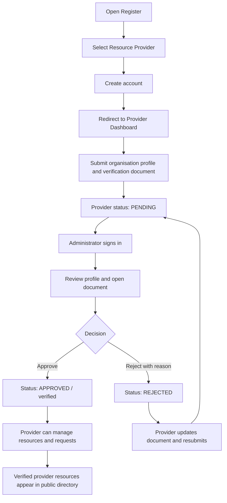
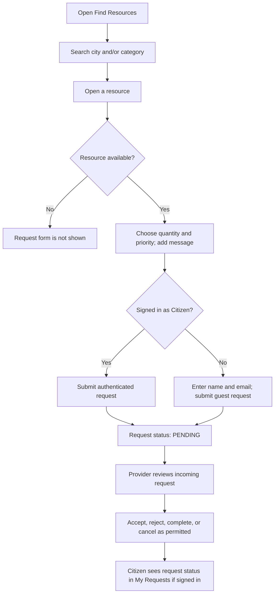

# Sahayak Website Workflow and User Journeys 🚑

This document explains how a person uses Sahayak from account creation through provider verification, resource publishing, emergency requests, and administrator review.

**Repository:** https://github.com/snehalpawar29/sahayak  
**Application:** Sahayak — Emergency Resource Finder

## 1. User roles

| Role | Purpose | Main screens |
|---|---|---|
| Visitor / Guest | Browse verified-provider resources and submit an emergency request without creating an account | Home, Find Resources, Resource Details |
| Citizen | Browse resources, request help, and see the requests associated with their account | Resources, Resource Details, My Requests |
| Provider | Create a provider profile, submit a verification document, and—after approval—manage resources and incoming requests | Provider Dashboard |
| Administrator | Review provider profiles and documents, approve/reject providers, and inspect providers, resources, and emergency requests | Admin Login, Admin Dashboard |

Public registration allows **CITIZEN** and **PROVIDER** accounts. An administrator cannot create an ADMIN account through the public registration form; the admin account must be provisioned through the authorised administrative/seed process.

## 2. Website navigation and access

| URL | Access | Purpose |
|---|---|---|
| `/` | Public | Landing page and introduction to Sahayak |
| `/register` | Public | Create a citizen or provider account |
| `/login` | Public | Sign in to a citizen or provider account |
| `/resources` | Public | Search the resource directory by city and category |
| `/resources/:id` | Public | View resource details and submit a request if available |
| `/my-requests` | Signed-in CITIZEN | View requests submitted by that account |
| `/provider` | Signed-in PROVIDER | Provider profile, verification state, resources, and incoming requests |
| `/admin/login` | Public login page | Sign in with an existing ADMIN account |
| `/admin/dashboard` | ADMIN only | Provider verification and emergency-request administration |

The backend enforces roles on protected API endpoints as well as the frontend's route checks. Hiding or visiting a page is not a replacement for server-side authorisation.

## 3. At-a-glance end-to-end flows

### Provider onboarding and approval

> **Implementation note:** The intended resubmission step has a frontend/backend route mismatch in the current code. See **Section 10 — Known implementation alignment items** before relying on document resubmission.

### Citizen / guest emergency request

## 4. Visitor and account registration flow

### 4.1 Visitor enters the website

The home page introduces Sahayak and offers the **Find Resources** action. Signed-out visitors can also choose **Become a Provider**, which opens the registration page.

### 4.2 Create an account

At `/register`, the user enters:

- Full name
- Email address
- City (optional)
- Account type: `CITIZEN` or `PROVIDER`
- Password (minimum 8 characters)

When submitted, the backend:

1. Validates required fields and the password length.
2. Normalises the email to lowercase and checks whether it is already registered.
3. Rejects any role other than `CITIZEN` or `PROVIDER`.
4. Hashes the password before storing it.
5. Creates the account and issues a JWT.

The frontend stores the token in `localStorage` under `sahayak_token`.

### 4.3 Redirect after registration or sign-in

- A `PROVIDER` account is redirected to `/provider`.
- A `CITIZEN` account is redirected to `/resources`.
- On a later sign-in, the application uses the same role-based default destination unless a protected route requested a redirect.

On application reload, the authentication context checks the stored token through the current-user endpoint. If the token is invalid, it clears the token and treats the user as signed out.

## 5. Provider profile creation and verification

### 5.1 Provider signs in

The provider signs in at `/login` and opens `/provider`. A newly registered provider may not yet have a provider organisation profile, so the dashboard presents **Register as a Provider**.

### 5.2 Submit the provider profile

The current provider form displays these fields:

| Field | Required in the form? |
|---|---|
| Organization Name | Yes |
| Organization Type | Yes — NGO, Hospital, Blood Bank, Pharmacy, Ambulance Service, Shelter, or Other |
| Contact Person | Yes in the form |
| Contact Number | Yes |
| City | Yes |
| Registration Number | Yes in the form |
| Organization Address | Yes |
| Description | No |
| Registration document | Yes — PDF, JPG, or PNG; maximum 4 MB |

The provider must submit the organisation details and an allowed document. The document is stored with the provider record for administrator review.

The backend sets the provider profile initially to:

- `verificationStatus = PENDING`
- `verified = false`

The dashboard shows the profile and verification state. A pending provider cannot create, edit, delete, or manage resources until an administrator approves the profile.

### 5.3 Administrator reviews the provider

The administrator opens `/admin/login` and signs in using an existing `ADMIN` account. The Admin Dashboard loads provider and emergency-request data.

For provider verification, the administrator can:

1. Open the provider list and select a profile.
2. Review the organisation, contact/account details, type, city, address and status.
3. Open the submitted verification document.
4. Approve the provider if the required document is present, or reject the provider with a reason.

Approval sets the provider to `APPROVED`, sets `verified = true`, and records the verification time. Verified providers can manage resources, and their resources are eligible to appear in the public resource finder.

Rejection sets the provider status to `REJECTED`, keeps the provider profile, records the reason, and leaves `verified = false`. The reason should tell the provider what needs correction.

### 5.4 Provider corrects a rejected submission

The intended flow is for a rejected provider to read the rejection reason, upload an updated registration document, and submit it for another review. The status should return to `PENDING` after a valid resubmission.

See Section 10: the current frontend and backend do not agree on the resubmission endpoint and payload, so that specific action needs alignment before it can be considered a verified end-to-end flow.

## 6. Approved provider manages resources

Once approved, a provider can use the Provider Dashboard to register and maintain emergency resources.

### 6.1 Create a resource

The provider chooses the resource registration form and enters:

- Resource name
- Category
- Quantity (non-negative integer)
- City
- Address
- Description (if provided)
- Availability

The supported resource categories are:

- `BLOOD`
- `HOSPITAL_BED`
- `MEDICINE`
- `AMBULANCE`
- `SHELTER`
- `FOOD`
- `WATER`

The backend associates the resource with the authenticated provider profile. It does not trust a provider ID supplied by the browser.

### 6.2 Manage existing resources

In **All My Resources**, an approved provider can:

- View their resources
- Edit a resource's details
- Change availability
- Delete a resource after confirming the action

The backend checks that the resource belongs to the authenticated provider before allowing updates or deletion. Other providers cannot manage that resource.

### 6.3 Public visibility

The public resource directory only returns resources belonging to verified providers. A resource detail request for a resource owned by an unverified provider is not exposed as an available public resource.

## 7. Citizen and guest resource-request flow

### 7.1 Search for resources

At `/resources`, a visitor or citizen can search by:

- City
- Resource category

The categories include blood, hospital beds, medicine, ambulances, shelter, food and water. Each resource card links to `/resources/:id` for further details.

The details page displays resource name, category, provider organisation, location, address, quantity, availability and last update time.

### 7.2 Submit a request

The request form is shown when the resource is marked available and the visitor is either signed out or signed in as a citizen.

The form contains:

- Quantity requested (must be positive and cannot exceed the listed quantity)
- Priority: `LOW`, `MEDIUM`, `HIGH`, or `CRITICAL`
- Optional message describing the emergency

For a signed-out guest, the form also requires a name and email address. Guest submissions are rate-limited to five requests per 15 minutes per rate-limit identity.

For a signed-in citizen, the request is associated with that citizen's account. The backend validates the resource, verifies that its provider is approved, checks availability and quantity, and creates the request with status `PENDING`.

### 7.3 Track requests as a citizen

Signed-in citizens open `/my-requests` to see their requests, including resource, provider, quantity, priority, current status, submission time and any rejection reason.

Guest requests are recorded with the supplied requester name and email but are not associated with a logged-in citizen account. The current `/my-requests` page lists requests associated with the signed-in account; it is not a guest-request tracking page.

## 8. Provider handles incoming emergency requests

An approved provider opens the Provider Dashboard and selects **Incoming Requests**. The dashboard loads requests associated with that provider's resources.

For a pending request, the provider can:

- **Accept** the request.
- **Reject** the request with a reason of at least five characters.

The API also permits setting statuses such as `COMPLETED` and `CANCELLED` subject to its existing transition checks. Accept/reject actions are restricted to pending requests. The backend verifies that the request belongs to a resource owned by the authenticated provider.

Available request statuses are:

| Status | Meaning |
|---|---|
| `PENDING` | Waiting for provider action |
| `ACCEPTED` | Provider accepted the request |
| `REJECTED` | Provider rejected the request; a reason is recorded |
| `COMPLETED` | Request marked complete |
| `CANCELLED` | Request marked cancelled |

The citizen can see the current status and, if rejected, the rejection reason on the My Requests page.

## 9. Administrator workflow

### 9.1 Administrator sign-in

The administrator opens `/admin/login`, enters email and password, and is redirected to `/admin/dashboard` only if the account returned by the backend has role `ADMIN`.

The public registration endpoint does not create administrator accounts. The database seed script uses `ADMIN_EMAIL`, `ADMIN_PASSWORD` and optional `ADMIN_NAME` environment variables to create or update the admin user. Because the seed script updates the password for an existing admin email, only run it intentionally with the intended credentials.

### 9.2 Admin dashboard capabilities

The current Admin Dashboard supports:

- View provider records and their verification statuses.
- Filter/review pending provider profiles.
- Open provider details and verification documents.
- Approve providers when the required document is present.
- Reject providers with a mandatory reason (at least five characters).
- Browse all emergency requests, search/filter them, and open request details.
- Inspect provider resources and resource details in read-only mode.

The current admin request workflow is review-oriented: the backend exposes list/read endpoints for all requests, but the admin routes do not provide request accept/reject actions. Request handling is assigned to the provider who owns the requested resource.

The admin API is protected by authentication middleware and an `ADMIN` role check.

## 10. Known implementation alignment items

These items are visible in the current repository code and should be fixed or verified before documenting these subflows as fully operational.

### 10.1 Provider document resubmission endpoint does not match

- The Provider Dashboard calls `PATCH /api/providers/resubmit-document` and sends a multipart field named `document`.
- The backend currently exposes `POST /api/providers/verification-document` and its controller expects JSON fields `documentBase64`, `documentName` and `documentMimeType`.

Those contracts do not match. Update the frontend and backend to use the same path, HTTP method, content type and field names, then test rejected-provider resubmission end to end.

### 10.2 Some provider form fields are not persisted by the current create request

The frontend requires `Contact Person` and `Registration Number` and displays `Description`, but the profile-creation payload currently sends only organisation, type, city, address, phone, and verification document fields. The backend provider model/creation handler currently persists the latter fields, not contact person, registration number or provider description.

If those fields are intended to be real profile data, add them to the Prisma model and migration, backend validation/handler, and frontend payload before relying on them in the admin review process.

### 10.3 Rejection reason field name should be consistent

The backend stores the provider rejection reason as `verificationRejectionReason`. The provider dashboard currently looks for `rejectionReason`/`rejectionNotes` when displaying the rejection notice. Align the field name so a rejected provider sees the administrator's actual reason.

### 10.4 Resource search availability filter

The Resources page sends an `available=true` query parameter, but the current resource controller filters by city/category and verified provider status; it does not apply the `available` query parameter. The details page hides the request form for an unavailable resource, but the search results may still include unavailable resources until the backend filter is implemented.

## 11. Main API endpoints behind these flows

| Method | Endpoint | Purpose / access |
|---|---|---|
| `POST` | `/api/auth/register` | Create a citizen/provider account |
| `POST` | `/api/auth/login` | Sign in and issue JWT |
| `GET` | `/api/auth/me` | Read signed-in user profile |
| `GET` | `/api/providers` | Public directory of verified providers |
| `POST` | `/api/providers` | Create a provider profile; authenticated provider |
| `GET` | `/api/providers/me` | Read own provider profile; authenticated provider |
| `POST` | `/api/providers/verification-document` | Backend document-update handler currently exposed by the provider router |
| `GET` | `/api/resources` | Public resource search |
| `GET` | `/api/resources/:id` | Public resource details, subject to provider verification |
| `POST` | `/api/resources` | Create resource; authenticated and verified provider |
| `PATCH` | `/api/resources/:id` | Update own resource; authenticated and verified provider |
| `DELETE` | `/api/resources/:id` | Delete own resource; authenticated and verified provider |
| `POST` | `/api/requests/guest` | Submit request without a citizen account; rate-limited |
| `POST` | `/api/requests` | Submit authenticated citizen request |
| `GET` | `/api/requests/my` | List own citizen requests |
| `GET` | `/api/requests/provider` | List incoming requests for provider's resources |
| `PATCH` | `/api/requests/:id/status` | Provider updates status of a request belonging to their resource |
| `GET` | `/api/admin/providers` | Admin lists providers |
| `GET` | `/api/admin/providers/pending` | Admin lists pending providers |
| `GET` | `/api/admin/providers/:id/document` | Admin views provider verification document |
| `PATCH` | `/api/admin/providers/:id/approve` | Admin approves provider |
| `DELETE` | `/api/admin/providers/:id/reject` | Admin rejects provider; reason required in JSON body |
| `GET` | `/api/admin/requests` | Admin lists all emergency requests |

## 12. Summary

Sahayak links three operational journeys:

1. **Provider journey:** register an account → create an organisation profile → submit verification documentation → wait for administrator approval → publish and maintain emergency resources → manage incoming requests.
2. **Citizen journey:** search verified-provider resources → open resource details → submit a guest or signed-in request → track status when signed in.
3. **Administrator journey:** sign in with an existing admin account → inspect provider details and documents → approve/reject providers → review providers, resources and emergency requests.

Provider approval is the central trust boundary: only verified providers can manage resources, and only resources belonging to verified providers are exposed through the public resource APIs.
