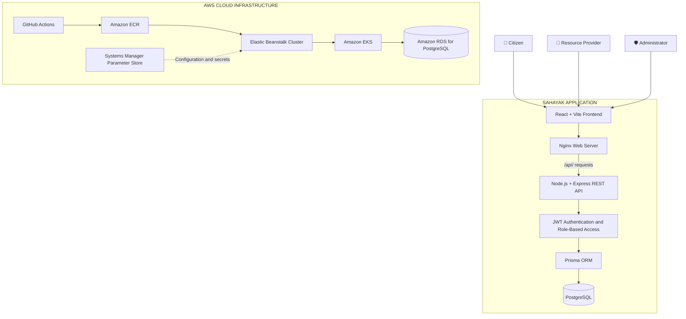
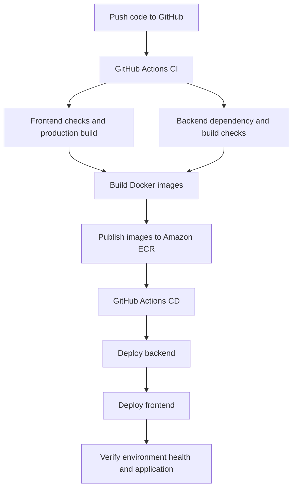

 
<div align="center">

# 🚨 SAHAYAK
### Emergency Resource Finder

**Connecting people with essential emergency resources — when every minute matters.**

<p>
  
  
  
  
  
  
</p>

[📂 Source Code](https://github.com/snehalpawar29/sahayak) ·
[⚙️ CI Workflow](.github/workflows/ci.yaml) ·
[🚀 CD Workflow](.github/workflows/cd.yaml) ·
[📖 Deployment Guide](SAHAYAK_DEPLOYMENT_GUIDE.md)

</div>

---

## 🌍 About the project

During an emergency, finding essential resources quickly can be challenging. **Sahayak** is a full-stack emergency resource finder designed to connect citizens, resource providers, and administrators through one platform.

The project combines an emergency-resource management application with containerization, cloud infrastructure, automated delivery, and managed database services on AWS.

**The goal:** make emergency-resource information easier to discover, requests easier to manage, and the underlying application easier to deploy and maintain.

## ✨ Key capabilities

<table>
<tr>
<td width="33%" valign="top">

### 🧑 Citizens

- Browse available resources
- Explore emergency-resource categories
- Submit resource requests
- Specify quantity and priority
- Track request status

</td>
<td width="33%" valign="top">

### 🏥 Resource providers

- Register an organization
- Submit provider information for verification
- Create and manage resource listings
- Maintain resource availability
- Review incoming requests

</td>
<td width="33%" valign="top">

### 🛡️ Administrators

- Review provider verification requests
- Approve or reject provider applications
- Oversee platform activity
- Manage access to administrative functionality

</td>
</tr>
</table>

### 🚑 Emergency-resource categories

| Category | Purpose |
|---|---|
| 🩸 Blood | Blood resource listings |
| 🏥 Hospital beds | Hospital-bed availability |
| 💊 Medicine | Essential medicines |
| 🚑 Ambulance | Emergency transportation |
| 🏠 Shelter | Temporary shelter |
| 🍱 Food | Food assistance |
| 💧 Water | Water assistance |

## 🖼️ Application screenshots

### 🏠 Application homepage

<p align="center">
  
</p>

### 🚑 Emergency-resource catalogue

<p align="center">
  
</p>

### 📝 Resource-request workflow

<p align="center">
  
</p>

### 📋 Citizen request tracking

<p align="center">
  
</p>

### 🏥 Provider dashboard

<p align="center">
  
</p>

### 🛡️ Administrator dashboard

<p align="center">
  
</p>


## 🏗️ System architecture



### 🔄 How it works

1. A user accesses Sahayak through the web interface.
2. The frontend sends API requests through the Nginx `/api/` proxy.
3. The Express backend processes requests and applies the relevant authentication and authorization rules.
4. Prisma communicates with PostgreSQL to read or update application data.
5. The frontend displays resource information and request status to the user.

## 🧰 Technology stack

| Layer | Technologies |
|---|---|
| Frontend | React, Vite, React Router |
| Backend | Node.js, Express.js, REST API |
| Authentication | JSON Web Tokens (JWT), role-based access |
| ORM | Prisma |
| Database | PostgreSQL, Amazon RDS |
| Containerization | Docker, Docker Compose |
| Image registry | Amazon Elastic Container Registry (ECR) |
| Cloud deployment | AWS Elastic Beanstalk Cluster, Amazon EKS |
| Configuration and secrets | AWS Systems Manager Parameter Store |
| CI/CD | GitHub Actions |
| AWS authentication | IAM roles and OpenID Connect (OIDC) |
| Logging and metrics | Amazon CloudWatch |

## ⚙️ DevOps and CI/CD pipeline

Sahayak uses GitHub Actions to automate application validation, container-image publishing, and deployment to AWS.



### 🚀 Pipeline stages

- **Continuous Integration:** validate the application, run configured frontend checks, and build application artifacts.
- **Containerization:** build the frontend and backend Docker images.
- **Image publishing:** publish versioned images to Amazon ECR.
- **Continuous Deployment:** update the configured Elastic Beanstalk environments.
- **Post-deployment verification:** check environment health, API responses, frontend loading, and application functionality.

### 🔐 AWS authentication and configuration

- GitHub Actions can authenticate to AWS through OIDC and an appropriately scoped IAM role.
- Application configuration and sensitive values are managed through AWS Systems Manager Parameter Store.
- Amazon ECR stores the container images used for deployment.
- Amazon CloudWatch provides centralized logs and metrics.

**Workflow files:** [CI](.github/workflows/ci.yaml) · [CD](.github/workflows/cd.yaml)

> Deployment success should be confirmed using actual workflow results, environment health, and application tests. A successful image build alone does not guarantee a healthy deployment.

## ☁️ AWS deployment status

The backend has been deployed and its root endpoint is responding with the Sahayak API welcome message.

| Component | Status |
|---|---|
| Backend API | ✅ Root endpoint responding |
| Frontend environment | ⏳ Deployment and verification in progress |
| Amazon ECR | Container-image registry configured |
| PostgreSQL | Amazon RDS deployment |
| CI/CD | GitHub Actions workflows configured |

**Backend root response:**

```json
{
  "success": true,
  "message": "Welcome to Sahayak API",
  "version": "1.0.0"
}
```

This response confirms that the backend root endpoint responds. It does not independently verify database connectivity, authentication, or every API route.

## 🚀 Run locally

### Prerequisites

- Git
- Node.js and npm
- Docker and Docker Compose
- A reachable PostgreSQL database and valid environment configuration

### 1. Clone the repository

```bash
git clone https://github.com/snehalpawar29/sahayak.git
cd sahayak
```

### 2. Configure environment variables

Review the backend configuration and root `docker-compose.yml` before starting the services.

| Variable | Purpose |
|---|---|
| `DATABASE_URL` | PostgreSQL connection string |
| `JWT_SECRET` | JWT signing secret |
| `JWT_EXPIRES_IN` | Token lifetime, such as `7d` |
| `FRONTEND_URL` | Frontend origin |
| `PORT` | Backend port, configured as `5000` |

Use local development values. Never commit production credentials, secret values, AWS access keys, or populated `.env` files.

### 3. Start the configured services

After confirming the Compose configuration and environment values:

```bash
docker compose pull
docker compose up -d
docker compose ps
```

Inspect service logs:

```bash
docker compose logs --tail=100
```

**Note:** If the Compose file references private Amazon ECR images, authenticate to ECR before pulling them. Local execution also requires the correct database connection and application environment variables.

### 4. Test the API

If the backend is running locally:

```bash
curl -i http://localhost:5000/
```

The root endpoint should return the Sahayak API welcome response. Use the application's actual health endpoint separately to test service health.

For AWS deployment and troubleshooting, see the [Sahayak Deployment Guide](SAHAYAK_DEPLOYMENT_GUIDE.md).

## 📁 Repository structure

```text
sahayak/
├── .github/
│   └── workflows/
│       ├── ci.yaml
│       └── cd.yaml
├── backend/
│   ├── prisma/
│   │   └── migrations/
│   ├── src/
│   └── Dockerfile
├── frontend/
│   ├── src/
│   ├── nginx.conf
│   └── Dockerfile
├── deployment/
│   └── elastic-beanstalk/
├── docs/
│   └── screenshots/
├── docker-compose.yml
├── SAHAYAK_DEPLOYMENT_GUIDE.md
└── README.md
```

## 🔒 Security and operational practices

- Keep the production RDS database private.
- Restrict PostgreSQL ingress to the intended application security group.
- Store production secrets securely and grant workloads only the required permissions.
- Avoid committing secrets or printing them in workflow logs.
- Validate the Nginx API proxy and CORS configuration where applicable.
- Check environment health after every deployment.
- Monitor CloudWatch logs and metrics for application failures.
- Review AWS costs for RDS, load balancers, NAT gateways, EKS/Elastic Beanstalk resources, and networking.

## 🛣️ Future roadmap

The next improvements focus on **reliability, security, observability, and emergency-resource usability**.

### 🧪 Application quality

- [ ] Add automated backend unit and integration tests.
- [ ] Add API tests for authentication, authorization, and resource-request workflows.
- [ ] Validate request payloads and standardize API error responses.
- [ ] Add database indexes and review query performance as data grows.
- [ ] Add pagination, filtering, and sorting for larger resource catalogues.

### 🚨 Emergency-resource experience

- [ ] Add location-based resource discovery with distance-aware filtering.
- [ ] Add resource availability timestamps and stale-listing indicators.
- [ ] Implement request notifications and status updates.
- [ ] Add duplicate-request prevention and clear request lifecycle states.
- [ ] Improve accessibility, mobile responsiveness, and low-bandwidth usability.

### 🔐 Security and resilience

- [ ] Add rate limiting and stronger validation for sensitive endpoints.
- [ ] Review authorization rules to prevent users from accessing other users' requests.
- [ ] Configure database backup retention and test restoration procedures.
- [ ] Add dependency and container-image vulnerability scanning.
- [ ] Document recovery procedures for failed deployments and database incidents.

### ☁️ DevOps and observability

- [ ] Add automated post-deployment smoke tests to GitHub Actions.
- [ ] Fail deployments when critical health checks do not pass.
- [ ] Add CloudWatch dashboards, alarms, and actionable notifications.
- [ ] Add infrastructure validation and drift detection for Terraform-managed resources.
- [ ] Use immutable image tags and retain a documented rollback procedure.
- [ ] Track deployment outcomes and improve release reliability.

## 👩‍💻 About the developer

**Snehal Pawar**  
Aspiring DevOps & Cloud Engineer | AWS | Linux | Docker | Kubernetes | CI/CD

Building practical experience in cloud infrastructure, containerization, automated deployment, and reliable application delivery through hands-on projects.

<p>
  <a href="https://github.com/snehalpawar29">
    
  </a>
  <a href="https://linkedin.com/in/snehalpawar29">
    
  </a>
</p>

---

<div align="center">

### 🌍 Built with purpose. Automated with DevOps.

**Sahayak — helping people find essential resources when they need them most.** ❤️

⭐ If you find this project useful, consider starring the repository.

</div>
